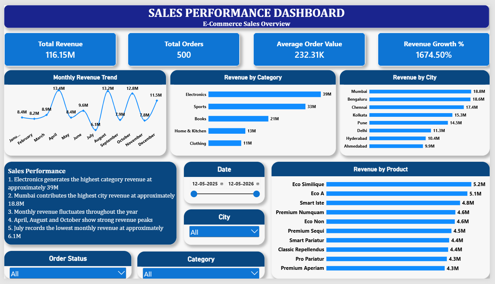
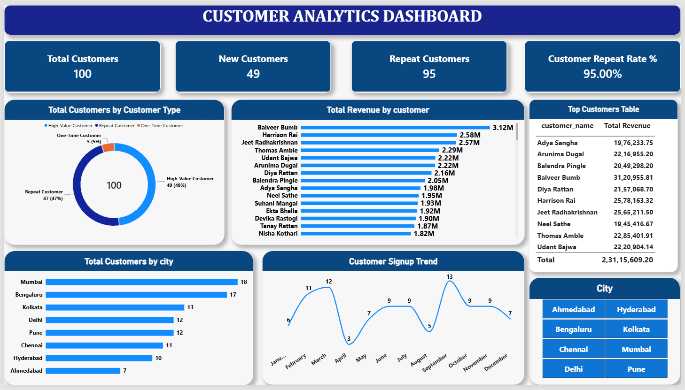
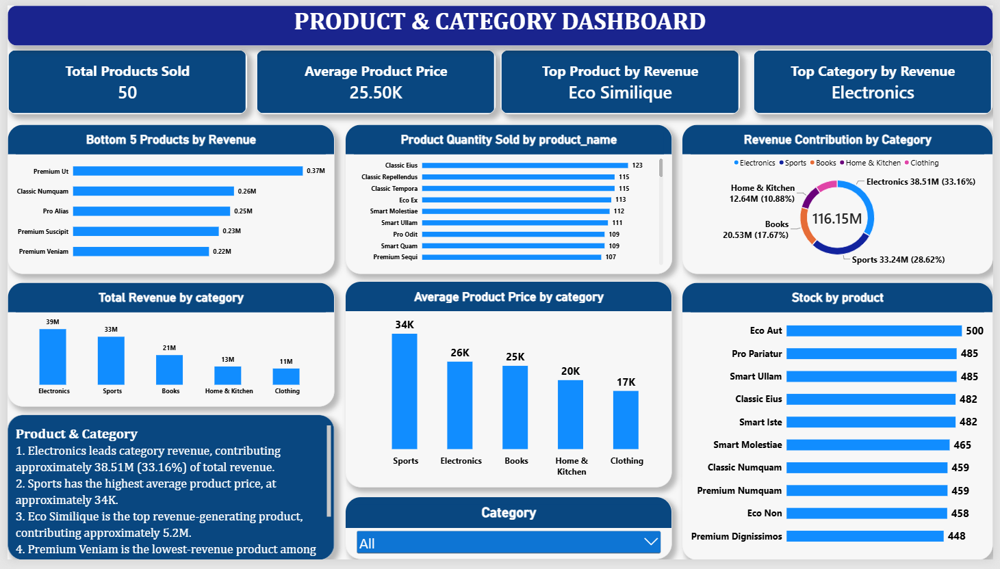
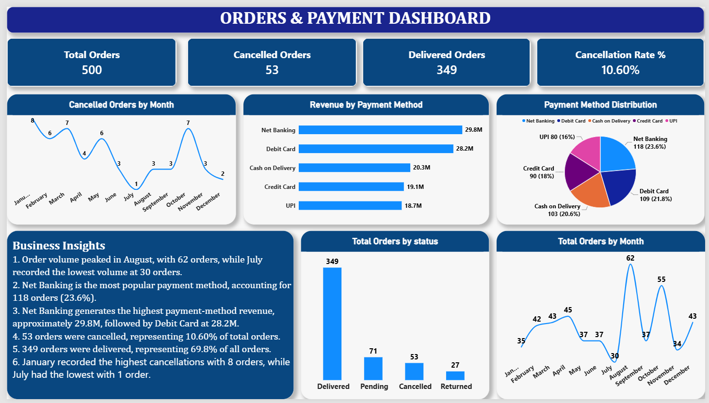
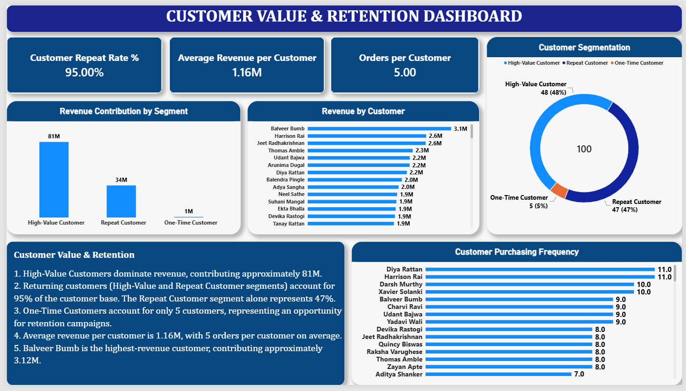
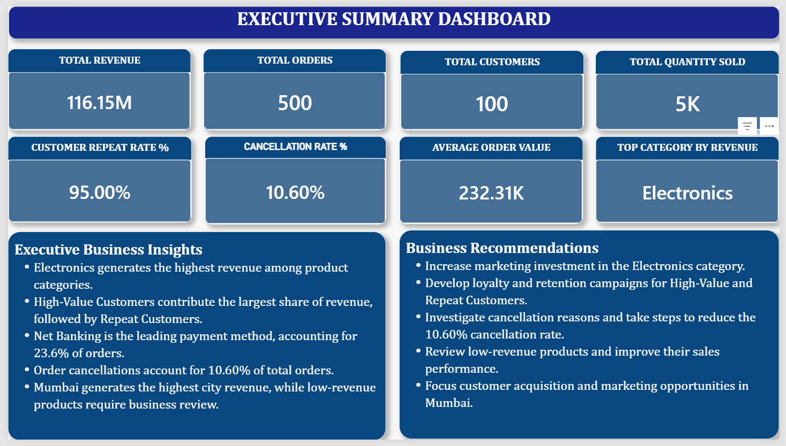

# E-Commerce-Sales-Customer-Analytics
Power BI project for E-Commerce Sales, Customer and Product Analysis
# E-Commerce Sales, Customer & Product Analytics

## Project Overview
This project focuses on analyzing E-Commerce sales, customer behavior, product performance, order status, and payment methods using Microsoft Power BI.

The goal is to convert raw business data into meaningful insights through interactive dashboards and visualizations.

## Tools & Technologies
- Microsoft Power BI
- Power Query
- DAX (Data Analysis Expressions)
- Microsoft Excel / CSV files

## Dataset Description
The project uses four datasets:

- **Customers:** Customer details and signup dates.
- **Orders:** Order dates, customer IDs, order status, and payment methods.
- **Order Items:** Product quantities and unit prices.
- **Products:** Product names, categories, and prices.

A Calendar table was also created in Power BI for date-based analysis.

## Data Preparation
- Checked data types.
- Applied Trim and Clean transformations to text columns.
- Used Column Quality, Column Distribution, and Column Profile.
- Performed data quality checks using Power Query.

## Data Model
Created relationships between Customers, Orders, Order Items, Products, and Calendar tables using a relational data model.

## Key Analysis Areas
1. Sales Performance Analysis
2. Customer Analytics
3. Product & Category Analysis
4. Orders & Payment Analysis
5. Customer Value & Retention Analysis
6. Executive Summary

## Power BI Dashboard Preview

### 1. Sales Performance Dashboard

### 2. Customer Analytics Dashboard

### 3. Product & Category Dashboard

### 4. Orders & Payment Dashboard

### 5. Customer Value & Retention Dashboard

### 6. Executive Summary Dashboard

## Key Business Insights
- Electronics generated the highest revenue among product categories.
- Mumbai was the highest-revenue city.
- August recorded the highest number of orders.
- The analysis identified customer segments based on customer value and repeat purchasing.
- Net Banking was the most frequently used payment method.

## Project Deliverables
- Power BI dashboard (`.pbix`)
- Project report (`.pdf`)
- Business insights document
- Business recommendations document
- Screenshots of Power Query transformations and data model

## Author
**Dhiraj N. Bhamburkar**

## Conclusion
This project demonstrates how Power BI, Power Query, and DAX can be used to analyze E-Commerce data and support data-driven business decisions.
